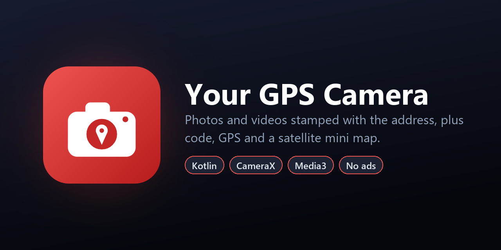

<p align="center">
  
</p>

<p align="center">
  <a href="https://github.com/souvik-das-tech/GPSCamera-Android/releases/latest"></a>
  
  
  
  
  
</p>

# Your GPS Camera

A GPS map camera for site visits, field work, deliveries and events. Every **photo and video**
is stamped with where and when it was taken: a satellite mini map with a pin, the place name,
the full address with a plus code, the coordinates, the date and time, and your own company
logo, event name and note.

> This is the native **Kotlin + Jetpack Compose** edition. A Flutter edition with a bundled
> offline geocoder for India lives at [GPSCamera_INDIA_Offline](https://github.com/souvik-das-tech/GPSCamera_INDIA_Offline).

## Download

Get the latest APK from **[Releases](https://github.com/souvik-das-tech/GPSCamera-Android/releases/latest)**
(Android 8.0 or newer).

## Features

- **Photo and video modes** with a live stamp preview over the camera, front/back lens and
  flash (a steady torch while recording video).
- **Rich location stamp**: satellite mini map, place title (e.g. *Atrakhi, West Bengal,
  India*), full address with plus code (*8F3P+JRG, Atrakhi, West Bengal 721149, India*),
  latitude/longitude, and the date and time with time zone.
- **Your branding** on every capture: company name and logo, an event badge in the top-left
  corner, and a free-text note. You set them on first launch and can change them any time.
- **Stamped videos**: the stamp updates while you record (each new minute, or when the
  address arrives) and is burned into the frames on the device.
- **Proper metadata**: GPS is written to the photo's EXIF tags and to the MP4 location atom.
- **Keep shooting**: captures are processed in a background queue, one after another.
- **Built-in gallery** with a grid and a swipeable full-screen viewer, share and delete. Every
  capture is also saved to the phone's gallery in the *Your GPS Camera* album.
- **No ads, no accounts.**

## How it works

| Piece | Implementation |
| --- | --- |
| Camera | **CameraX**: photos up to 12 MP, video at 1080p |
| Location | Google Play services' fused location provider, with plain GPS as a fallback on phones without Play services |
| Address | Android's built-in `Geocoder`, falling back to OpenStreetMap **Nominatim** (rate-limited, only queried after moving 40 m or more) |
| Plus code | Open Location Code encoder implemented from the open specification, using exact integer arithmetic |
| Mini map | Esri World Imagery tiles stitched into one square, centred on the position (Web Mercator) |
| Video stamp | **Media3 Transformer** overlays the stamp images onto the video frames, entirely on-device |
| Stamp drawing | One drawing routine paints both the live preview and the stamp burned into photos and videos |

## Project structure

```
app/src/main/java/com/bbcl/gpscamera/
├── MainActivity.kt      Entry point
├── CameraScreen.kt      Camera preview, live stamp, capture controls
├── CameraModel.kt       CameraX binding, stamp state, background capture queue
├── LocationTracker.kt   Fused / GPS location updates
├── Address.kt           Geocoder + Nominatim reverse geocoding
├── PlusCode.kt          Open Location Code encoder
├── MiniMap.kt           Satellite tile stitching
├── Stamp.kt             Stamp layout and drawing
├── VideoStamper.kt      Media3 Transformer overlay pipeline
├── Media.kt             Final photo/video output, EXIF, gallery export
├── Brand.kt             Company / event / note / logo storage
├── BrandDialog.kt       Branding editor
└── GalleryScreen.kt     In-app gallery and viewer
```

## Tech stack

- **Kotlin 2.4**, **Jetpack Compose** (Material 3), Coroutines
- **CameraX** (camera2, video, view), **Media3** Transformer and Effect
- Google Play services Location, AndroidX ExifInterface
- Min SDK 26 (Android 8.0), target SDK 36

## Permissions

| Permission | Why |
| --- | --- |
| `CAMERA` | Taking photos and videos |
| `ACCESS_FINE_LOCATION` / `ACCESS_COARSE_LOCATION` | The position on the stamp |
| `RECORD_AUDIO` | Sound in videos |
| `INTERNET` | Address lookup and satellite map tiles (the stamp still shows coordinates offline) |
| `WRITE_EXTERNAL_STORAGE` (Android 9 and lower) | Saving to the gallery |

## Build from source

Requirements: Android Studio (or the Android SDK with platform 36) and JDK 17+.

```bash
git clone https://github.com/souvik-das-tech/GPSCamera-Android.git
cd GPSCamera-Android
./gradlew assembleRelease     # app/build/outputs/apk/release/app-release.apk (R8-minified)
./gradlew installDebug        # install a debug build on a connected device
```

The release build is signed with the debug key so it installs out of the box. Add your own
`signingConfig` before publishing to a store.

## Credits

Satellite imagery © Esri and its data providers. Addresses © OpenStreetMap contributors (ODbL)
via Nominatim.

## License

Released under the [MIT License](LICENSE).

## Author

**Souvik Das** · [GitHub @souvik-das-tech](https://github.com/souvik-das-tech)

If you find this project useful, please consider giving it a ⭐.
